# Terraform + Ansible on AWS: 5-Server Lab

A hands-on project that builds **5 Ubuntu servers on AWS with Terraform**, then turns one of them into an **Ansible control node** that configures the other four:

- **Security hardening** on every server (firewall, locked-down SSH, fail2ban)
- **nginx** on every server
- **Python** on two servers, **Node.js** on the other two
- A **dynamic inventory**: Ansible asks AWS which servers exist, so there are no hard-coded IP addresses
- **Ansible Vault**: the only password in the project is stored encrypted
- **Roles**: the standard, reusable way to organise Ansible code

The README assumes **no prior Ansible knowledge**. It explains every file, every command and how the pieces connect.

---

## Table of contents

1. [Architecture](#1-architecture)
2. [Project structure](#2-project-structure)
3. [Key concepts for beginners](#3-key-concepts-for-beginners)
4. [Prerequisites](#4-prerequisites)
5. [Step 1: Create the servers with Terraform](#5-step-1-create-the-servers-with-terraform)
6. [Step 2: Set up the Ansible control node](#6-step-2-set-up-the-ansible-control-node)
7. [Step 3: Dynamic inventory (finding servers automatically)](#7-step-3-dynamic-inventory-finding-servers-automatically)
8. [Step 4: Ansible Vault (storing the password safely)](#8-step-4-ansible-vault-storing-the-password-safely)
9. [Step 5: Bootstrap (deploy user and separate SSH key)](#9-step-5-bootstrap-deploy-user-and-separate-ssh-key)
10. [Step 6: The main playbook, site.yml](#10-step-6-the-main-playbook-siteyml)
11. [How all the Ansible files connect](#11-how-all-the-ansible-files-connect)
12. [The roles in detail](#12-the-roles-in-detail)
13. [Verifying everything works](#13-verifying-everything-works)
14. [Everyday workflows and scenarios](#14-everyday-workflows-and-scenarios)
15. [Command reference](#15-command-reference)
16. [Troubleshooting](#16-troubleshooting)
17. [Security notes: what is and isn't in git](#17-security-notes-what-is-and-isnt-in-git)
18. [Cleaning up](#18-cleaning-up)
19. [Ideas for extending the project](#19-ideas-for-extending-the-project)

---

## 1. Architecture

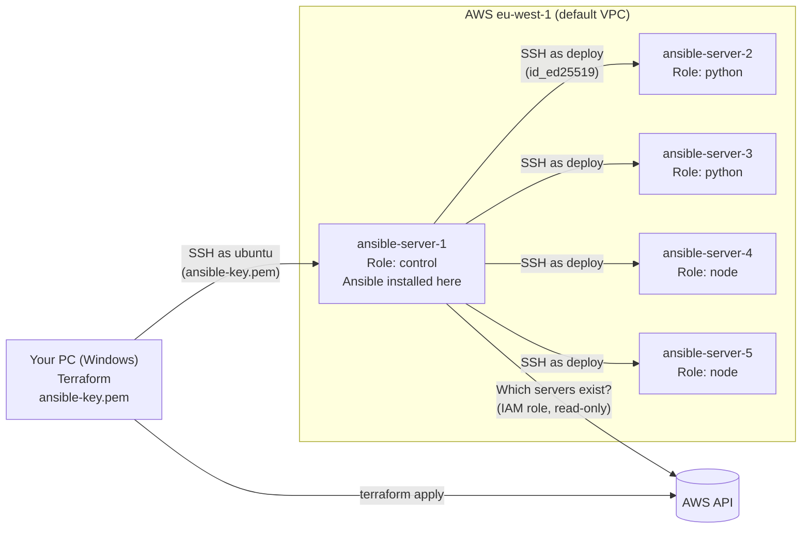

| Server | `Role` tag | What it gets |
|---|---|---|
| ansible-server-1 | `control` | Ansible itself. This is where you run playbooks from |
| ansible-server-2 | `python` | Hardening + nginx + Python 3, pip, venv |
| ansible-server-3 | `python` | Hardening + nginx + Python 3, pip, venv |
| ansible-server-4 | `node` | Hardening + nginx + Node.js, npm |
| ansible-server-5 | `node` | Hardening + nginx + Node.js, npm |

All servers are `t3.micro` running **Ubuntu 24.04** in region **eu-west-1** (Ireland).

---

## 2. Project structure

```
.
├── README.md                       ← you are here
├── .gitignore                      ← keeps secrets (keys, state, vault password) out of git
│
├── terraform/                      ← PART 1: creates the infrastructure (runs on your PC)
│   ├── providers.tf                ← which plugins Terraform uses (aws, tls, local)
│   ├── variables.tf                ← settings: region, instance type
│   ├── main.tf                     ← SSH key, firewall, IAM role, the 5 servers
│   ├── outputs.tf                  ← prints the server IPs after "apply"
│   └── .terraform.lock.hcl         ← pins exact provider versions (committed)
│
└── ansible/                        ← PART 2: configures the servers (runs on server-1)
    ├── ansible.cfg                 ← Ansible settings for this folder
    ├── aws_ec2.yml                 ← dynamic inventory: asks AWS for the server list
    ├── bootstrap.yml               ← run ONCE: creates deploy user + new SSH key
    ├── site.yml                    ← MAIN playbook: run any time
    ├── group_vars/
    │   └── all/
    │       ├── main.yml            ← variables for all servers (user, key, sudo password)
    │       └── vault.yml           ← ENCRYPTED secrets (the deploy user's password)
    └── roles/
        ├── hardening/              ← firewall, SSH lockdown, fail2ban
        │   ├── defaults/main.yml   ← default settings (allowed ports, trusted IPs)
        │   ├── tasks/main.yml      ← the steps
        │   └── handlers/main.yml   ← restart ssh / fail2ban when config changes
        ├── nginx/                  ← web server
        │   ├── tasks/main.yml
        │   └── handlers/main.yml
        ├── python/                 ← Python, pip, venv
        │   ├── defaults/main.yml   ← list of packages
        │   └── tasks/main.yml
        └── node/                   ← Node.js and npm
            ├── defaults/main.yml   ← list of packages
            └── tasks/main.yml
```

**Files that are created locally and never committed** (see [Security notes](#17-security-notes-what-is-and-isnt-in-git)):

| File | Where | What it is |
|---|---|---|
| `terraform/ansible-key.pem` | Your PC | Private SSH key created by Terraform |
| `terraform/terraform.tfstate` | Your PC | Terraform's record of what it created |
| `~/.vault_pass.txt` | server-1 | The password that unlocks `vault.yml` |
| `~/.ssh/id_ed25519` | server-1 | Second SSH key, created by `bootstrap.yml` |

---

## 3. Key concepts for beginners

### Terraform

| Term | Meaning |
|---|---|
| **Infrastructure as Code** | You describe servers, firewalls etc. in files; a tool creates them for you. |
| **Provider** | A plugin that lets Terraform talk to a service (here: `aws`, `tls` for keys, `local` for files). |
| **Resource** | One thing Terraform manages, e.g. one EC2 instance or one security group. |
| **Data source** | Something Terraform *reads* but doesn't create, e.g. "the latest Ubuntu image". |
| **State file** | `terraform.tfstate`: Terraform's memory of what it created. Kept **locally** in this project. |
| **Plan / Apply** | `plan` shows what *would* change; `apply` actually does it. |

### Ansible

| Term | Meaning |
|---|---|
| **Control node** | The machine where Ansible is installed and run from (here: **server-1**). |
| **Managed nodes** | The machines Ansible configures (here: **servers 2-5**). They need nothing but SSH and Python, which Ubuntu already has. |
| **Agentless** | Ansible installs nothing permanent on managed nodes. It just connects with SSH, runs a step and leaves. |
| **Inventory** | The list of servers and how they are grouped. Here it's **dynamic** (fetched from AWS). |
| **Group** | A named set of servers, e.g. `python_servers`. Playbooks target groups instead of IPs. |
| **Module** | A built-in unit of work, e.g. `apt` (install packages), `service` (start/stop services), `copy` (write a file). |
| **Task** | One call to a module with some settings: "install nginx". |
| **Play** | A set of tasks (or roles) applied to a group of servers. |
| **Playbook** | A YAML file with one or more plays. You run it with `ansible-playbook`. |
| **Role** | A folder that bundles tasks, handlers, variables and files for one job (e.g. `nginx`). Reusable and tidy. |
| **Handler** | A task that runs **only when notified** by another task that changed something, e.g. "restart ssh". |
| **Variables** | Values you can change without editing tasks. Here they live in `defaults/` and `group_vars/`. |
| **become** | Run as root (like `sudo`). |
| **Vault** | Ansible's built-in encryption for secrets. |
| **Idempotent** | Running the same playbook again doesn't redo work. Tasks describe the **desired state** ("nginx is installed"), not commands ("install nginx"). If the state is already correct, nothing changes. |

### Reading Ansible output

| Colour / word | Meaning |
|---|---|
| 🟢 **ok** | Already in the desired state, nothing done |
| 🟡 **changed** | Ansible made a change to reach the desired state |
| 🔵 **skipping** | Task's condition didn't apply |
| 🔴 **failed** / **unreachable** | Something went wrong / couldn't connect |

At the end of every run, the **PLAY RECAP** summarises this per server. A healthy run has `failed=0 unreachable=0`. A second run straight after a first one should show `changed=0`, which is idempotency in action.

---

## 4. Prerequisites

On **your PC**:

- An **AWS account**
- **Terraform** ≥ 1.5 ([install](https://developer.hashicorp.com/terraform/install))
- **AWS CLI v2** ([install](https://docs.aws.amazon.com/cli/latest/userguide/getting-started-install.html)), used to log in
- An SSH client (`ssh` and `scp` are built into Windows 10/11, macOS and Linux)

You do **not** need Ansible on your PC; it gets installed on server-1.

> 💰 **Cost:** 5 × `t3.micro` running 24/7. `t3.micro` is Free Tier eligible, but free allowances are limited and differ by account type. Run `terraform destroy` when you aren't using the lab (see [Cleaning up](#18-cleaning-up)).

---

## 5. Step 1: Create the servers with Terraform

All commands in this section run on **your PC**.

### 5.1 Log in to AWS

```powershell
aws login
```

This opens your browser, signs you in, and saves a temporary session in `~/.aws/config`. Terraform picks it up automatically. There are no access keys in this project.

> Alternative: set the environment variables `AWS_ACCESS_KEY_ID`, `AWS_SECRET_ACCESS_KEY` and `AWS_DEFAULT_REGION` in the terminal. They only last for that terminal window, and they take priority over `aws login` if set.

Check who you are logged in as:

```powershell
aws sts get-caller-identity
```

### 5.2 What the Terraform files do

**[`providers.tf`](terraform/providers.tf)** lists the three plugins Terraform downloads:

| Provider | Used for |
|---|---|
| `hashicorp/aws` | Everything in AWS (servers, firewall, IAM) |
| `hashicorp/tls` | Generating an SSH key pair |
| `hashicorp/local` | Saving the private key to a file on your PC |

**[`variables.tf`](terraform/variables.tf)** holds settings you might want to change: `region` (default `eu-west-1`) and `instance_type` (default `t3.micro`).

**[`main.tf`](terraform/main.tf)** creates the following, in order:

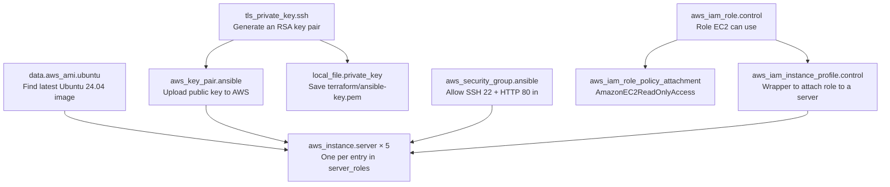

| Block | Explanation |
|---|---|
| `data "aws_ami" "ubuntu"` | Looks up the newest official Ubuntu 24.04 image from Canonical (owner `099720109477`). |
| `tls_private_key` + `aws_key_pair` + `local_file` | Creates an SSH key, uploads the **public** half to AWS (as `ansible-key`), saves the **private** half to `terraform/ansible-key.pem`. AWS puts the public key on every server so this one private key can log in as `ubuntu`. |
| `aws_security_group` | A firewall in front of the servers: SSH (22) and HTTP (80) in from anywhere, everything out. |
| `aws_iam_role` + policy + instance profile | Gives **server-1 only** permission to *read* EC2 information. The dynamic inventory needs this. No access keys are ever stored on the server. |
| `locals { server_roles = [...] }` | `["control", "python", "python", "node", "node"]`. The **length** of this list decides how many servers are created, and each entry becomes that server's `Role` tag. |
| `aws_instance.server` | `count = 5` creates 5 copies. Each gets a `Name` tag (`ansible-server-1` … `-5`) and a `Role` tag. `iam_instance_profile` is only set when the role is `control`. |

**[`outputs.tf`](terraform/outputs.tf)** prints `public_ips` (in order server-1 … server-5) and an example SSH command after `apply`.

### 5.3 Run Terraform

```powershell
cd terraform
terraform init       # download providers (first time only, or after changing providers.tf)
terraform plan       # preview: on a fresh account it shows "12 to add"
terraform apply      # create everything; type "yes" to confirm
terraform output     # show the IPs again at any time
```

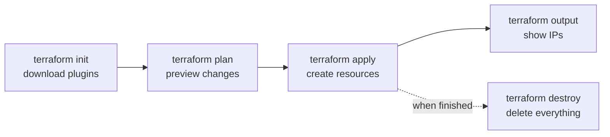

Example output:

```
public_ips = [
  "3.250.190.83",      ← server-1 (control)
  "34.247.166.63",     ← server-2
  ...
]
ssh_command_example = "ssh -i terraform/ansible-key.pem ubuntu@3.250.190.83"
```

### 5.4 State is kept locally

Terraform writes `terraform/terraform.tfstate`. This file:

- is how Terraform knows what it already created (so the next `apply` only changes the difference)
- **contains the private SSH key** in plain text, because Terraform generated it
- is **ignored by git** and must never be committed or shared

If you lose the state file, Terraform forgets the servers exist. They keep running, and you'd have to delete them in the AWS console.

---

## 6. Step 2: Set up the Ansible control node

### 6.1 Fix the key's permissions (Windows only, once)

SSH refuses to use a private key that other users on the PC can read:

```powershell
cd terraform
icacls ansible-key.pem /inheritance:r /grant:r "$($env:USERNAME):R"
```

On macOS/Linux use `chmod 400 ansible-key.pem` instead.

### 6.2 Log in to server-1

```powershell
ssh -i ansible-key.pem ubuntu@<server-1-public-ip>
```

The first time, type `yes` to trust the server. Your prompt changes to `ubuntu@ip-172-31-xx-xx:~$`. You are now on server-1.

### 6.3 Install Ansible and its helpers (on server-1)

```bash
sudo apt update
sudo apt install -y ansible python3-boto3 python3-passlib
ansible --version
```

| Package | Why |
|---|---|
| `ansible` | Ansible itself, plus the standard collections (`amazon.aws`, `community.general`, `ansible.posix`) |
| `python3-boto3` | AWS library the dynamic inventory uses to talk to AWS |
| `python3-passlib` | Used to hash the deploy user's password |

### 6.4 Copy the project and the key to server-1

From **your PC**, in the project root:

```powershell
# the original key: needed once, by bootstrap.yml
scp -i terraform\ansible-key.pem terraform\ansible-key.pem ubuntu@<server-1-ip>:~/.ssh/

# the whole ansible/ folder → ~/ansible on server-1
scp -i terraform\ansible-key.pem -r ansible ubuntu@<server-1-ip>:~/
```

On **server-1**:

```bash
chmod 400 ~/.ssh/ansible-key.pem
cd ~/ansible
```

> **Workflow rule:** edit files on your PC (that's what goes to GitHub), then re-run the `scp -r` command to update server-1. `scp` overwrites files but never deletes them, so remove deleted files on server-1 by hand.

> **Always run Ansible commands from inside `~/ansible`.** That's where Ansible finds `ansible.cfg`.

### 6.5 What `ansible.cfg` does

```ini
[defaults]
inventory = aws_ec2.yml               # where the server list comes from
host_key_checking = False             # don't ask "trust this server?" for each new server
vault_password_file = ~/.vault_pass.txt   # how to unlock vault.yml automatically
```

Without this file you'd type `-i aws_ec2.yml --vault-password-file ~/.vault_pass.txt` on every command.

---

## 7. Step 3: Dynamic inventory (finding servers automatically)

A normal inventory is a text file of IP addresses. When servers are recreated, IPs change and the file breaks. A **dynamic inventory** asks AWS for the current list every time Ansible runs.

### 7.1 How it works

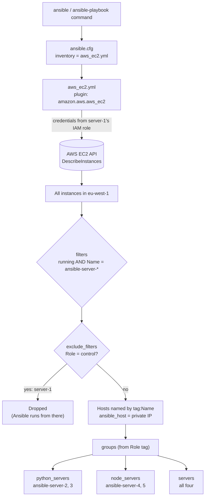

### 7.2 `aws_ec2.yml` line by line

| Setting | What it does |
|---|---|
| `plugin: amazon.aws.aws_ec2` | Use the AWS EC2 inventory plugin. The file name **must end in `aws_ec2.yml`**. |
| `regions: [eu-west-1]` | Only look in this region. |
| `filters` | Only **running** instances whose `Name` tag matches `ansible-server-*`. |
| `exclude_filters` | Leave out anything tagged `Role: control` (server-1). |
| `hostnames: [tag:Name]` | Show servers as `ansible-server-2` instead of an IP. |
| `compose: ansible_host: private_ip_address` | Connect over the **private** IP. It works inside the VPC and doesn't change when a server is stopped and started. |
| `groups:` | Build groups from the `Role` tag. These are the names `site.yml` targets. |

### 7.3 Try it

```bash
ansible-inventory --graph        # tree of groups and hosts
ansible-inventory --list         # everything Ansible knows, as JSON (IPs, tags, ...)
ansible all -m ping              # can Ansible reach and log in to every server?
```

Expected `--graph`:

```
@all:
  |--@ungrouped:
  |--@aws_ec2:
  |  |--ansible-server-2
  |  |--ansible-server-3
  |  |--ansible-server-4
  |  |--ansible-server-5
  |--@python_servers:
  |  |--ansible-server-2
  |  |--ansible-server-3
  |--@node_servers:
  |  |--ansible-server-4
  |  |--ansible-server-5
  |--@servers:
  |  |--ansible-server-2
  |  |--ansible-server-3
  |  |--ansible-server-4
  |  |--ansible-server-5
```

---

## 8. Step 4: Ansible Vault (storing the password safely)

The `deploy` user (created in the next step) needs a password for `sudo`. Ansible needs that password too, but it must never appear in GitHub as plain text.

### 8.1 The two pieces

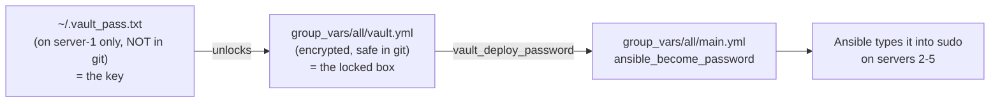

| File | Contains | In git? |
|---|---|---|
| `~/.vault_pass.txt` | The **vault password** (unlocks the vault) | ❌ Never |
| `group_vars/all/vault.yml` | The **deploy user's password**, encrypted | ✅ Yes, it's unreadable without the vault password |

### 8.2 Create them (on server-1)

```bash
# 1. The vault password: choose one and remember it
nano ~/.vault_pass.txt          # type the password, Ctrl+O, Enter, Ctrl+X
chmod 600 ~/.vault_pass.txt     # only you can read it

# 2. The encrypted secrets file
cd ~/ansible
EDITOR=nano ansible-vault create group_vars/all/vault.yml
```

In the editor, type **exactly** this format (a variable name, a colon, the value):

```yaml
vault_deploy_password: "a-strong-password-here"
```

> ⚠️ Typing only the password (without `vault_deploy_password:`) causes the error *"failed to combine variables, expected dicts"*. See [Troubleshooting](#16-troubleshooting).

### 8.3 Vault commands

| Command | What it does |
|---|---|
| `ansible-vault create FILE` | Create a new encrypted file (opens an editor) |
| `ansible-vault view FILE` | Show the decrypted content |
| `ansible-vault edit FILE` | Decrypt → edit → re-encrypt |
| `ansible-vault encrypt FILE` | Encrypt an existing plain-text file |
| `ansible-vault decrypt FILE` | Turn it back into plain text (careful!) |
| `ansible-vault rekey FILE` | Change the vault password |

Prefix with `EDITOR=nano` to use nano instead of vi. `cat group_vars/all/vault.yml` should show `$ANSIBLE_VAULT;1.1;AES256` followed by numbers, which confirms it's encrypted.

### 8.4 Copy the encrypted file back to your PC

So it gets committed with the rest of the project (run on your PC):

```powershell
scp -i terraform\ansible-key.pem ubuntu@<server-1-ip>:~/ansible/group_vars/all/vault.yml ansible\group_vars\all\
```

> Never create `vault.yml` in plain text on your PC. The next `scp -r` would overwrite the encrypted copy on server-1 with the plain one.

---

## 9. Step 5: Bootstrap (deploy user and separate SSH key)

### 9.1 Why

Terraform gave every server the **same** key (`ansible-key.pem`). If that key sits on server-1 and someone breaks into server-1, they can open every server. Bootstrap splits it into **two keys with two jobs**:

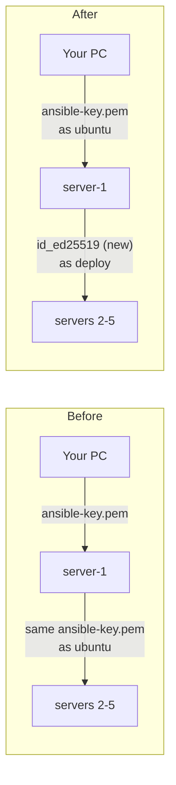

### 9.2 What `bootstrap.yml` does

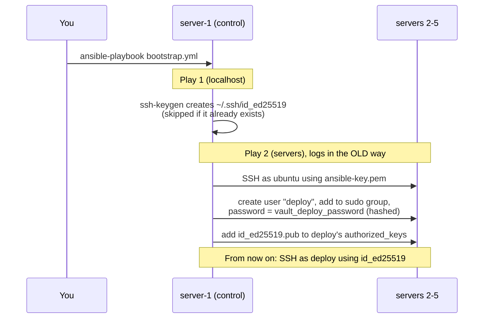

| Part | Detail |
|---|---|
| Play 1: `hosts: localhost`, `connection: local` | Runs **on server-1 itself**. `creates:` makes the `ssh-keygen` command idempotent: it's skipped if the key file exists. |
| Play 2: `vars: ansible_user: ubuntu` | **Play variables beat `group_vars`**, so this play alone connects the old way (the `deploy` user doesn't exist yet). |
| `user` module | Creates `deploy` in the `sudo` group. `password_hash('sha512')` stores a hash, never the plain password. `update_password: on_create` sets it only the first time, so reruns don't keep changing it. |
| `authorized_key` module | `lookup('file', ...)` reads the new **public** key on server-1 and installs it for `deploy` on each server. |

### 9.3 Run it

```bash
cd ~/ansible
ansible-playbook bootstrap.yml
```

Then prove the switch worked:

```bash
ansible all -m ping                       # pong ×4: logged in as deploy with the new key
ansible all -m command -a "whoami"        # deploy
ansible all -b -m command -a "whoami"     # root: sudo with the vault password works
```

Once [Step 6](#10-step-6-the-main-playbook-siteyml) and the [checks](#13-verifying-everything-works) pass, remove the old key from server-1:

```bash
rm ~/.ssh/ansible-key.pem
ansible all -m ping       # still works: Ansible only uses id_ed25519 now
```

Your PC keeps `ansible-key.pem` as an **emergency way in** (as `ubuntu`) to every server.

---

## 10. Step 6: The main playbook, `site.yml`

```yaml
- name: All servers
  hosts: servers            # all four
  become: true
  roles:
    - hardening
    - nginx

- name: Python servers
  hosts: python_servers     # server-2, server-3
  become: true
  roles:
    - python

- name: Node.js servers
  hosts: node_servers       # server-4, server-5
  become: true
  roles:
    - node
```

`site.yml` contains **no IPs and no tasks**. It only answers *"which group gets which role?"*. The details live in the inventory (where) and the roles (what).

```bash
ansible-playbook site.yml --syntax-check   # check for YAML/structure errors, changes nothing
ansible-playbook site.yml --list-hosts     # which servers each play will touch
ansible-playbook site.yml --list-tasks     # every task, in order
ansible-playbook site.yml --check --diff   # dry run: show what WOULD change
ansible-playbook site.yml                  # do it
```

### Which playbook when?

| Order | What | How often |
|---|---|---|
| 0 | `terraform apply` (PC) | Once, or when servers change |
| 0 | Control node setup + vault files (server-1) | Once per control node |
| 1 | **`bootstrap.yml`** (prerequisite) | Once, and again only for new servers |
| 2 | **`site.yml`** (main) | Any time, as often as you like |

---

## 11. How all the Ansible files connect

This is everything that happens when you type `ansible-playbook site.yml`:

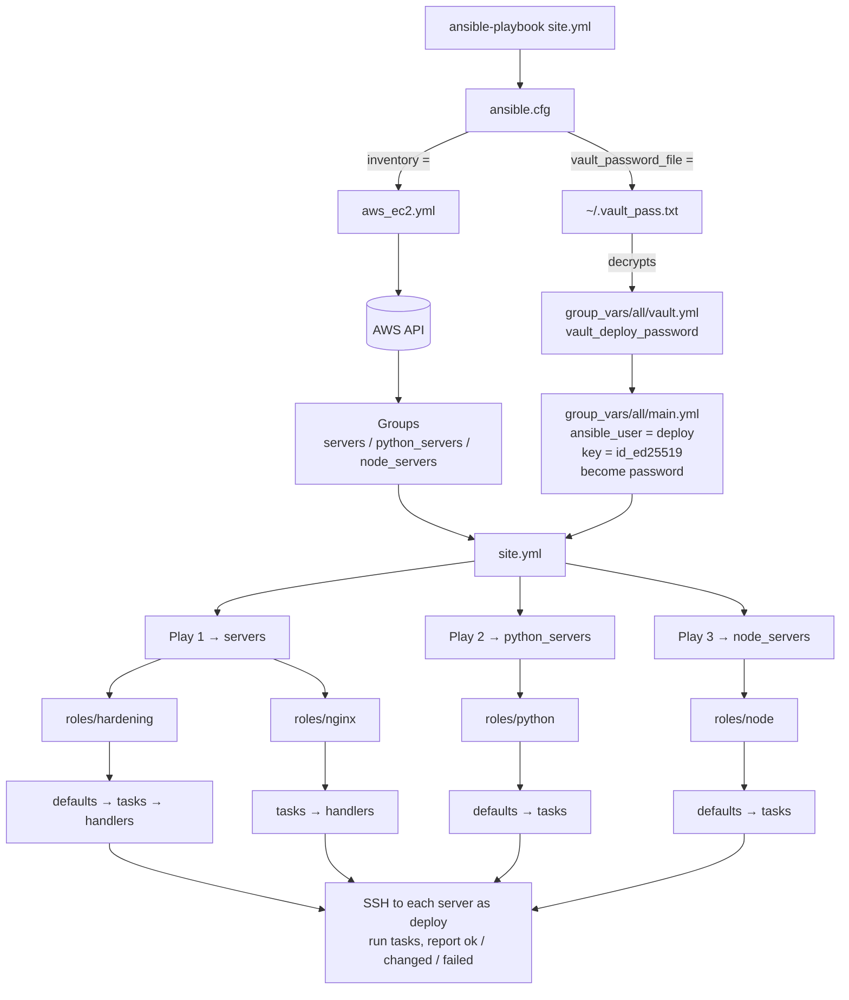

### Inside a role

When a play lists `roles: [nginx]`, Ansible looks for a `roles/` folder **next to the playbook** and loads:

| Sub-folder | Loaded | Purpose |
|---|---|---|
| `defaults/main.yml` | Automatically | Default variables (lowest priority, easy to override) |
| `tasks/main.yml` | Automatically | The steps, top to bottom |
| `handlers/main.yml` | Automatically | Tasks that run only when notified, **once, at the end of the play** |

### Where variables come from (simplified priority, low → high)

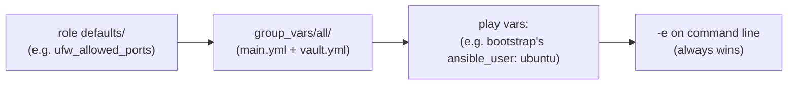

That's why `bootstrap.yml` can connect as `ubuntu` even though `group_vars` says `deploy`: play vars win.

---

## 12. The roles in detail

### 12.1 `hardening`: lock the servers down

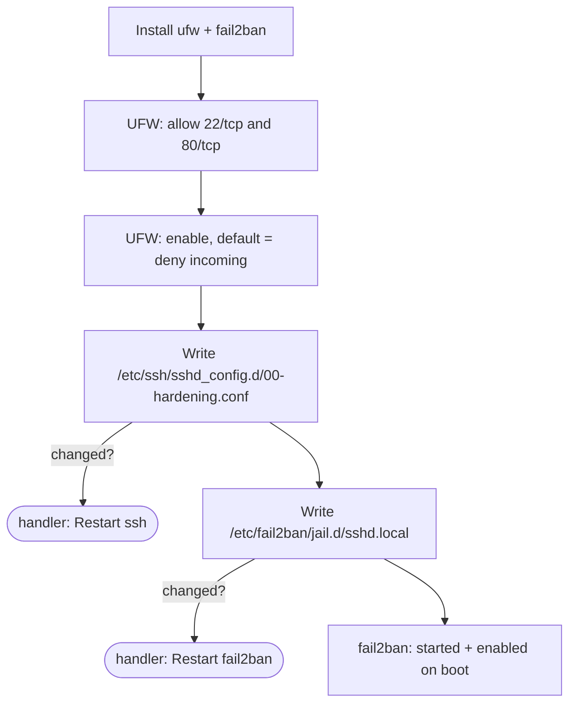

| Protection | Setting | What it means |
|---|---|---|
| **Firewall (UFW)** | Allow 22, 80. Deny everything else | Only SSH and web traffic can reach the server. The allow rules are added **before** the firewall is switched on, so Ansible never cuts off its own SSH connection. |
| **SSH** | `PermitRootLogin no` | Nobody can log in directly as root. |
| | `PasswordAuthentication no`, `KbdInteractiveAuthentication no` | Passwords are useless for SSH; only keys work. Brute-forcing passwords becomes pointless. |
| | `AllowUsers deploy ubuntu` | Only these two accounts may log in at all. |
| | File name `00-hardening.conf` | Ubuntu reads `sshd_config.d/*.conf` **in alphabetical order** and the **first** value wins, so `00-` makes sure these settings take effect. |
| **fail2ban** | `maxretry 5`, `findtime 10m`, `bantime 1h` | An IP with 5 failed logins within 10 minutes is blocked for 1 hour. |
| | `ignoreip 127.0.0.1/8 172.31.0.0/16` | Never ban localhost or the AWS VPC, so server-1 can't lock itself out. |

Settings you can change in [`roles/hardening/defaults/main.yml`](ansible/roles/hardening/defaults/main.yml): `ufw_allowed_ports`, `fail2ban_ignore_ips`.

### 12.2 `nginx`: web server

1. Install `nginx` (refreshing the package list first). Notifies **Restart nginx** if it was newly installed.
2. Make sure the service is **started** and **enabled** (starts on boot).

Open `http://<any-server-2-to-5-public-ip>` in a browser to see *"Welcome to nginx!"*.

### 12.3 `python`: Python tooling

Installs every package listed in `python_packages` ([`defaults/main.yml`](ansible/roles/python/defaults/main.yml)): `python3`, `python3-pip`, `python3-venv`. To add one, add it to the list. The task itself doesn't change.

### 12.4 `node`: Node.js tooling

Installs every package in `node_packages`: `nodejs`, `npm` (from Ubuntu's repositories).

---

## 13. Verifying everything works

Run on server-1 from `~/ansible`:

```bash
# Connection and identity
ansible all -m ping
ansible all -m command -a "whoami"          # → deploy
ansible all -b -m command -a "whoami"       # → root

# Software
ansible servers -a "systemctl is-active nginx"     # → active
ansible python_servers -a "python3 --version"
ansible node_servers -a "node --version"

# Hardening
ansible servers -b -a "ufw status"                 # → Status: active, 22 and 80 ALLOW
ansible servers -b -a "fail2ban-client status sshd"
ansible servers -b -a "sshd -T" | grep -E "permitrootlogin|passwordauthentication"
```

Prove that password login is refused (from your PC):

```powershell
ssh -o PubkeyAuthentication=no ubuntu@<server-2-public-ip>
# → Permission denied (publickey).
```

Prove idempotency: run `ansible-playbook site.yml` twice. The second recap should show `changed=0` for every server.

---

## 14. Everyday workflows and scenarios

### 14.1 First-time setup (full order)

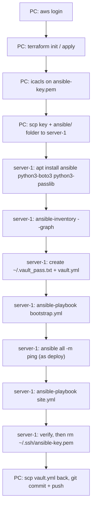

### 14.2 Change something (the normal loop)

Example: add `git` to the Python servers.

1. On your PC, edit [`ansible/roles/python/defaults/main.yml`](ansible/roles/python/defaults/main.yml) and add `- git`.
2. Copy to server-1: `scp -i terraform\ansible-key.pem -r ansible ubuntu@<server-1-ip>:~/`
3. On server-1: `ansible-playbook site.yml --check --diff` (preview), then `ansible-playbook site.yml`.
4. Only the new package shows `changed`. Commit and push from your PC.

### 14.3 Run against only some servers

```bash
ansible-playbook site.yml --limit ansible-server-2          # one server
ansible-playbook site.yml --limit python_servers            # one group
ansible-playbook site.yml --limit 'servers:!ansible-server-5'   # all except one
```

### 14.4 Run a quick one-off command (ad-hoc)

Ad-hoc commands use the same inventory and connection settings, without writing a playbook:

```bash
ansible <hosts-or-group> -m <module> -a "<arguments>" [-b]
```

```bash
ansible servers -a "uptime"
ansible servers -a "df -h /"
ansible servers -b -m apt -a "name=htop state=present"
ansible ansible-server-3 -b -m service -a "name=nginx state=restarted"
```

`-b` = become (sudo). Without `-m`, Ansible uses the `command` module.

### 14.5 Add more servers

1. In [`terraform/main.tf`](terraform/main.tf), extend the list, e.g. `["control", "python", "python", "node", "node", "node"]`.
2. `terraform apply`: creates `ansible-server-6` with `Role = node`. Existing servers are untouched.
3. The dynamic inventory picks it up automatically: `ansible-inventory --graph`.
4. The new server only has the `ubuntu` user, so it needs **bootstrap**, which needs `ansible-key.pem` on server-1 again:
   ```powershell
   scp -i terraform\ansible-key.pem terraform\ansible-key.pem ubuntu@<server-1-ip>:~/.ssh/
   ```
   ```bash
   chmod 400 ~/.ssh/ansible-key.pem
   ansible-playbook bootstrap.yml --limit ansible-server-6
   ansible-playbook site.yml --limit ansible-server-6
   rm ~/.ssh/ansible-key.pem
   ```

> Only add entries at the **end** of the list. Inserting in the middle shifts the numbering and Terraform would change the tags of existing servers.

### 14.6 Destroy and rebuild the whole lab

```powershell
terraform destroy      # deletes all 5 servers, key pair, security group, IAM role
terraform apply        # brand-new servers, new IPs, and a NEW ansible-key.pem
```

Everything on the old server-1 (Ansible install, `~/.vault_pass.txt`, `id_ed25519`) is gone, so redo [the first-time setup](#141-first-time-setup-full-order) from step C. You do **not** need to edit any inventory: `aws_ec2.yml` finds the new servers by their tags. Keep using the same vault password if you want to reuse the committed `vault.yml`.

### 14.7 Server IPs changed (stop/start)

Stopping and starting an instance (e.g. in the AWS console) gives it a **new public IP**; private IPs stay the same.

- Ansible on server-1 is unaffected (it uses private IPs).
- To SSH from your PC, get the new server-1 IP:
  ```powershell
  terraform apply -refresh-only   # update the state with the new IPs (type yes)
  terraform output public_ips
  ```

### 14.8 Using this repository yourself (fork / clone)

The committed `vault.yml` is encrypted with the original author's vault password, so you can't decrypt it. Replace it with your own:

```bash
rm group_vars/all/vault.yml
EDITOR=nano ansible-vault create group_vars/all/vault.yml
```

Then follow [First-time setup](#141-first-time-setup-full-order). Change `region` in `terraform/variables.tf` and `regions` in `ansible/aws_ec2.yml` if you're not using eu-west-1 (and `fail2ban_ignore_ips` if your VPC isn't `172.31.0.0/16`).

### 14.9 AWS session expired

`terraform plan` failing with *"No valid credential sources found"* or *"expired token"* means the `aws login` session has run out. Run `aws login` again. (Ansible on server-1 is unaffected; it uses the IAM role.)

---

## 15. Command reference

### Terraform (on your PC, in `terraform/`)

| Command | What it does |
|---|---|
| `terraform init` | Download providers. Needed once, or after changing `providers.tf` |
| `terraform fmt` | Auto-format `.tf` files |
| `terraform validate` | Check the files for errors (no AWS calls) |
| `terraform plan` | Show what would be created / changed / destroyed |
| `terraform apply` | Make the changes (asks for `yes`) |
| `terraform apply -refresh-only` | Update state with real-world changes (e.g. new IPs) |
| `terraform output` | Show outputs (IPs) |
| `terraform state list` | List everything Terraform manages |
| `terraform destroy` | Delete everything this project created |

### Getting to server-1 (on your PC)

| Command | What it does |
|---|---|
| `ssh -i terraform\ansible-key.pem ubuntu@<ip>` | Log in to a server |
| `scp -i terraform\ansible-key.pem -r ansible ubuntu@<ip>:~/` | Copy / update the Ansible project on server-1 |
| `scp -i terraform\ansible-key.pem <file> ubuntu@<ip>:<dest>` | Copy one file to the server |
| `scp -i terraform\ansible-key.pem ubuntu@<ip>:<file> <local-dest>` | Copy one file back to your PC |

### Ansible (on server-1, in `~/ansible`)

| Command | What it does |
|---|---|
| `ansible --version` | Version and which config file is in use |
| `ansible-inventory --graph` | Groups and hosts as a tree |
| `ansible-inventory --list` | Full inventory with all variables (JSON) |
| `ansible all -m ping` | Test SSH + Python on every host |
| `ansible <group> -a "<cmd>"` | Run a shell command on a group |
| `ansible <group> -b -m <module> -a "<args>"` | Run a module as root |
| `ansible-playbook bootstrap.yml` | One-time setup of the deploy user and key |
| `ansible-playbook site.yml` | Apply the full configuration |
| `ansible-playbook site.yml --syntax-check` | Check the playbook for errors |
| `ansible-playbook site.yml --check --diff` | Dry run, showing changes |
| `ansible-playbook site.yml --list-tasks` | List all tasks |
| `ansible-playbook site.yml --list-hosts` | List targeted hosts per play |
| `ansible-playbook site.yml --limit <host/group>` | Only run against some hosts |
| `ansible-playbook site.yml -v` / `-vvv` | More output, for debugging |
| `ansible-vault create / view / edit / rekey <file>` | Manage encrypted files |
| `ansible-galaxy collection list` | Installed collections (e.g. `amazon.aws`) |
| `ansible-doc <module>` | Built-in docs, e.g. `ansible-doc apt` |

---

## 16. Troubleshooting

These are real problems hit while building this project.

| Error / symptom | Cause | Fix |
|---|---|---|
| `InvalidParameterCombination: The specified instance type is not eligible for Free Tier` | Account on the AWS free plan; `t2.micro` isn't in its allowed list in this region | Use an eligible type (`t3.micro`). List them: `aws ec2 describe-instance-types --filters Name=free-tier-eligible,Values=true --query "InstanceTypes[].InstanceType"` |
| `No valid credential sources found` (Terraform) | Not logged in, credential env vars empty, or set in a different terminal | `aws login`, then retry. Check with `aws sts get-caller-identity` |
| `WARNING: UNPROTECTED PRIVATE KEY FILE!` | Key readable by other users | Windows: `icacls ansible-key.pem /inheritance:r /grant:r "$($env:USERNAME):R"`. Linux: `chmod 400` |
| `Permission denied (publickey)` | Wrong key, wrong user, or the user isn't in `AllowUsers` | From PC use `ubuntu` + `ansible-key.pem`; Ansible uses `deploy` + `id_ed25519` |
| `failed to combine variables, expected dicts but got a 'dict' and a 'AnsibleUnicode'` | `vault.yml` contains just a value, not `name: value` | `EDITOR=nano ansible-vault edit group_vars/all/vault.yml` → `vault_deploy_password: "..."` |
| `The vault password file ~/.vault_pass.txt was not found` | `ansible.cfg` points to a file that doesn't exist yet | Create it (see [Vault](#82-create-them-on-server-1)) |
| `Decryption failed` | Vault password doesn't match the one used to encrypt `vault.yml` | Use the right password, or recreate `vault.yml` |
| `ansible-inventory --graph` shows no hosts, or a boto/credentials error | `python3-boto3` missing, IAM role not attached yet, or wrong region | `sudo apt install python3-boto3`; wait a minute after `terraform apply`; check `regions:` |
| `[WARNING]: provided hosts list is empty` / `Unable to parse aws_ec2.yml` | Not running from `~/ansible`, so `ansible.cfg` isn't loaded | `cd ~/ansible`. `ansible --version` shows which config file is used |
| `UNREACHABLE` for a host | Server stopped, firewall/SG blocking 22, or wrong key | Check the instance is running; `ssh -v` to debug |
| `Missing sudo password` / `Incorrect sudo password` | `ansible_become_password` not resolving | `ansible-vault view group_vars/all/vault.yml`; variable name must be `vault_deploy_password` |
| `Error: Too many command line arguments` (Terraform in PowerShell) | PowerShell splits `-out=file.tfplan` | Quote it: `terraform plan "-out=file.tfplan"` |

---

## 17. Security notes: what is and isn't in git

| Item | In git? | Why |
|---|---|---|
| `terraform/*.tf`, `.terraform.lock.hcl` | ✅ | Code and provider versions |
| `ansible/**` (playbooks, roles, config) | ✅ | Code |
| `ansible/group_vars/all/vault.yml` | ✅ | Encrypted (AES-256); unreadable without the vault password |
| `terraform/terraform.tfstate*` | ❌ | Contains the private SSH key and resource details |
| `terraform/ansible-key.pem` | ❌ | Private SSH key |
| `~/.vault_pass.txt` | ❌ | Unlocks the vault |
| `~/.ssh/id_ed25519` | ❌ | Control node's private key (lives only on server-1) |
| AWS credentials | ❌ | Never in the project; `aws login` / IAM role only |

**Design choices worth noting:**

- **No AWS access keys anywhere.** Your PC uses `aws login`; server-1 uses an IAM role with **read-only** EC2 access.
- **Least privilege between machines.** Only server-1 can reach servers 2–5 as `deploy`; the PC key is kept as an emergency fallback.
- **Defence in depth on each server:** firewall + key-only SSH + allow-list of users + fail2ban.

**Known lab shortcuts (improve these for production):**

- Security group allows SSH from `0.0.0.0/0`. Restrict it to your IP (`<your-ip>/32`) in `main.tf`.
- Terraform generates the SSH key, so the private key ends up in the state file. In production, create the key yourself and give Terraform only the public key, or use AWS Systems Manager instead of SSH.
- State is local. Teams use a remote backend (e.g. S3 with locking).

---

## 18. Cleaning up

```powershell
cd terraform
terraform destroy      # type "yes"
```

This deletes the 5 servers, the key pair, the security group and the IAM role/profile. Afterwards `terraform/ansible-key.pem` is also removed. Check the EC2 console to confirm nothing is left running.

---

## 19. Ideas for extending the project

- **Real apps behind nginx:** a Flask app on the Python servers, an Express app on the Node servers, nginx as a reverse proxy (templates + handlers)
- **Load balancer:** one nginx spreading traffic across the app servers
- **Monitoring:** node_exporter on every server, Prometheus + Grafana on one
- **CI with GitHub Actions:** `ansible-lint`, `yamllint`, `terraform fmt -check`, `terraform validate` on every push
- **Full automation:** have Terraform install Ansible on server-1 via `user_data`
